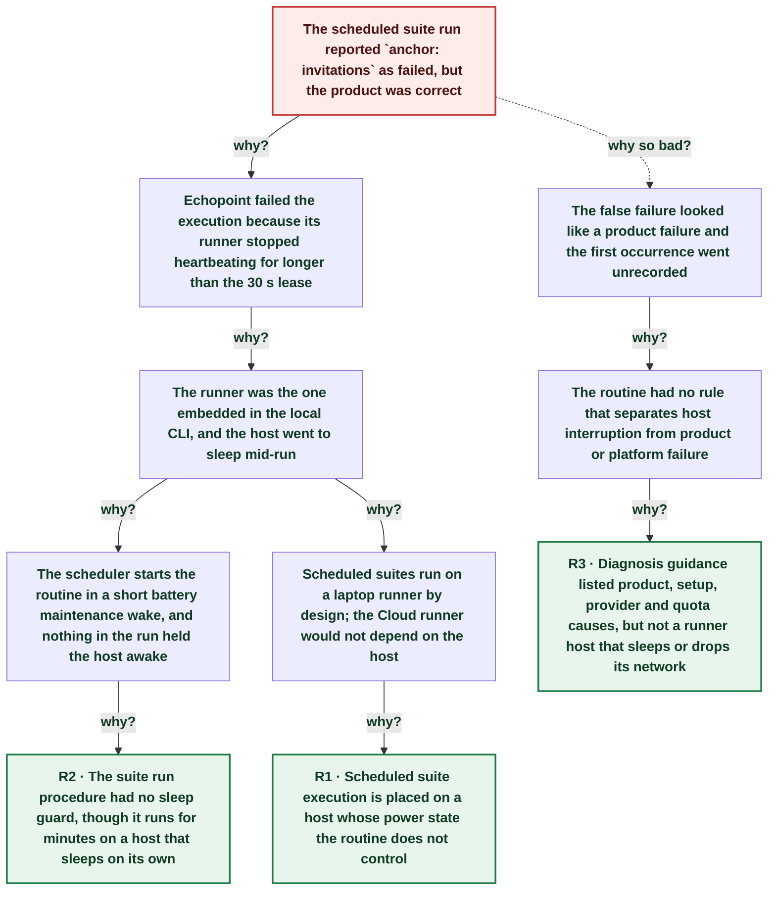

# Scheduled flow suite run reported a false failure: the laptop host slept and the embedded runner lost its job lease

| | |
|---|---|
| **Date** | 2026-10-17 |
| **Severity** | SEV4 |
| **Status** | In review |
| **Service** | echopoint-investigation routine (flow suites) |
| **Authors** | Nanostack routine (echopoint-investigation) |
| **Duration** | 27m 19s (trigger to resolution) |
| **Time to detect** | 22m 01s |
| **Time to mitigate** | ~22m 39s |

> Blameless: this document names systems, processes and missing guards, not people.

## Summary

The 19:00Z scheduled suite run started on a laptop in a 45 s battery maintenance wake. The suites run on the runner embedded in the local CLI, so when the host slept again at ~19:00:21Z, the `anchor: invitations` run stopped heartbeating and Echopoint failed it after its 30 s lease (`runner lease expired before completion`). The host slept until the lid opened at 19:22Z, so the anchor suite took 22 min instead of ~3 and reported 22/23. The flow passed twice on rerun; no product defect. The routine now runs suites through `run_suites.sh`, which holds a sleep assertion, reruns lease-expired flows once and prints the host sleep log, and the flow-suite-testing skill names host interruption as a diagnosis class.

## Impact

One false red flow in the anchor suite and a 22 min suite run. Dev only, no customer impact. Without the rule, the false failure could have opened a known-bugs flow or a product postmortem.

- **1 / 60** flows falsely red
- **22 min** anchor suite (normal ~3 min)
- **0** product defects

## Trigger

The host went back to sleep at ~19:00:21Z, 45 s after the maintenance wake that started the scheduled run.

## Detection

The routine saw the anchor suite still running after 22 min with `INVALID_JOB_TOKEN` and `RUNNER_JOB_COMPLETION_REJECTED` in the CLI log, then matched the gap to `pmset -g log`. A similar 2026-10-15 heartbeat reset was retried with no record, so the first occurrence was missed.

## Resolution

A sleep assertion (`caffeinate`) was attached to the running suite, and the interrupted flow was rerun twice, green. `run_suites.sh` now does both by default.

## Timeline (UTC)

| Time | | Event |
|---|---|---|
| ~17:08 | T−2d 01h | **Earlier heartbeat reset retried, not recorded** Run log 2026-10-15T17:08Z: one transient runner heartbeat reset, retried. |
| 18:59:36 | T−45s | **Maintenance wake on battery; scheduled run starts** `pmset -g log`: DarkWake from Deep Idle, rtc/Maintenance, Using BATT, 45 secs. |
| 19:00:14 | T−7s | **`anchor: invitations` starts on the CLI runner** Execution `01a14b3c-6f52-…`, runner_type ephemeral. |
| ~19:00 | T+0s | **Host sleeps mid-suite** End of the 45 s DarkWake. |
| 19:02:48 | T+2m 27s | **Echopoint fails the run: lease expired** `error_message: runner lease expired before completion`; `defaultRunnerLeaseTTL = 30s` in `internal/feature/runners/job_service.go`. |
| 19:15:59 | T+15m 38s | **2 s wake; heartbeat read times out** Host slept again at 19:16:01Z for 359 s. |
| 19:22:00 | T+21m 39s | **Lid wake; CLI resumes, job token rejected** `401 INVALID_JOB_TOKEN`, `409 RUNNER_JOB_COMPLETION_REJECTED`; the suite continues with the next flow. |
| 19:22:22 | T+22m 01s | **Routine links the gap to host sleep** |
| ~19:23 | T+22m 39s | **Sleep assertion attached to the running suite** `caffeinate -i -w <suite pid>` |
| 19:27:40 | T+27m 19s | **Interrupted flow green twice on rerun** Executions `01a14b54-…` and `01a14b55-…` completed. |
| ~19:45 | T+44m 39s | **`run_suites.sh` and skill lesson land** |

## Root cause analysis: the five whys

Start at the impact and ask why until the answer is something the team can change. Solid edges ask why it happened; dashed edges ask why the impact was as large as it was.

- **Problem:** The scheduled suite run reported `anchor: invitations` as failed, but the product was correct
  - **Why?** Echopoint failed the execution because its runner stopped heartbeating for longer than the 30 s lease _Evidence: Execution `01a14b3c-6f52-…` error `runner lease expired before completion`; `defaultRunnerLeaseTTL = 30 * time.Second`_
    - **Why?** The runner was the one embedded in the local CLI, and the host went to sleep mid-run _Evidence: `flows run` launches `(ephemeral)`; `pmset -g log` DarkWake 18:59:36Z for 45 s, then Sleep until 19:22:00Z lid wake_
      - **Why?** The scheduler starts the routine in a short battery maintenance wake, and nothing in the run held the host awake _Evidence: `DarkWake ... rtc/Maintenance Using BATT ... 45 secs`; suite command had no `caffeinate`_
        - **Why?** The suite run procedure had no sleep guard, though it runs for minutes on a host that sleeps on its own → **Root cause R2** (fixed by A1)
      - **Why?** Scheduled suites run on a laptop runner by design; the Cloud runner would not depend on the host _Evidence: Run notes: `echopoint flows run` executes on the CLI's embedded runner_
        - **Why?** Scheduled suite execution is placed on a host whose power state the routine does not control → **Root cause R1** (fixed by A3)
  - **Why so bad?** The false failure looked like a product failure and the first occurrence went unrecorded _Evidence: CLI shows only `✗ Flow ...: error` with a 409; 2026-10-15 run log: heartbeat reset retried, no ledger row_
    - **Why?** The routine had no rule that separates host interruption from product or platform failure
      - **Why?** Diagnosis guidance listed product, setup, provider and quota causes, but not a runner host that sleeps or drops its network → **Root cause R3** (fixed by A1, A2)

## Root causes

- **R2** The suite run procedure had no sleep guard, though it runs for minutes on a host that sleeps on its own
- **R1** Scheduled suite execution is placed on a host whose power state the routine does not control
- **R3** Diagnosis guidance listed product, setup, provider and quota causes, but not a runner host that sleeps or drops its network

## Contributing factors

- The laptop was on battery (39%), where macOS sleeps with the lid closed whatever assertions apps hold.

## Lessons learned

### What went well

- Echopoint failed the orphaned run after 30 s with a clear error message instead of leaving it running.
- The CLI moved on to the next flow after the rejection, so the rest of the suite still ran.

### What went wrong

- The 2026-10-15 occurrence was retried with no record, so the cause stayed unknown for two days.

### Where we got lucky

- The user opened the lid at 19:22Z; otherwise the suite could have run for hours and overlapped a post-deploy gate (409 FLOW_TREE_CONFLICT).
- The sleep hit a flow that does not own long-lived data; an interrupted run before its `always` cleanup could leave a throwaway org behind.

## Action items

| ID | Action | Type | Owner | Due | Status | Ticket | Fixes |
|---|---|---|---|---|---|---|---|
| A1 | Run suites through `run_suites.sh`: `caffeinate -ims`, rerun lease-expired flows once, print the host sleep log for the run window | prevent | echopoint-investigation routine | 2026-10-17 | done |  | R2, R3 |
| A2 | Name host interruption (lease-expired, job-token rejection) as a diagnosis class in the flow-suite-testing skill | detect | echopoint-investigation routine | 2026-10-17 | done |  | R3 |
| A3 | Decide where scheduled suites run: an always-on host (or AC power), or Cloud launches within the CI org daily budget | process | workspace owner | 2026-10-24 | open |  | R1 |

## Responders

- **Investigator**: Nanostack routine (echopoint-investigation)

## Messaging

### Internal

Suite run 2026-10-17T19:00Z: `anchor: invitations` false red because the laptop slept mid-run (lease expired). Rerun green twice. Suites now run under a sleep guard with an automatic rerun of host-interrupted flows.

### Customers

None: dev suites only.

## Supporting information

- [Report (artifact)](https://claude.ai/artifact/JFgnKfLB3chZaAv2mU3RcS)
