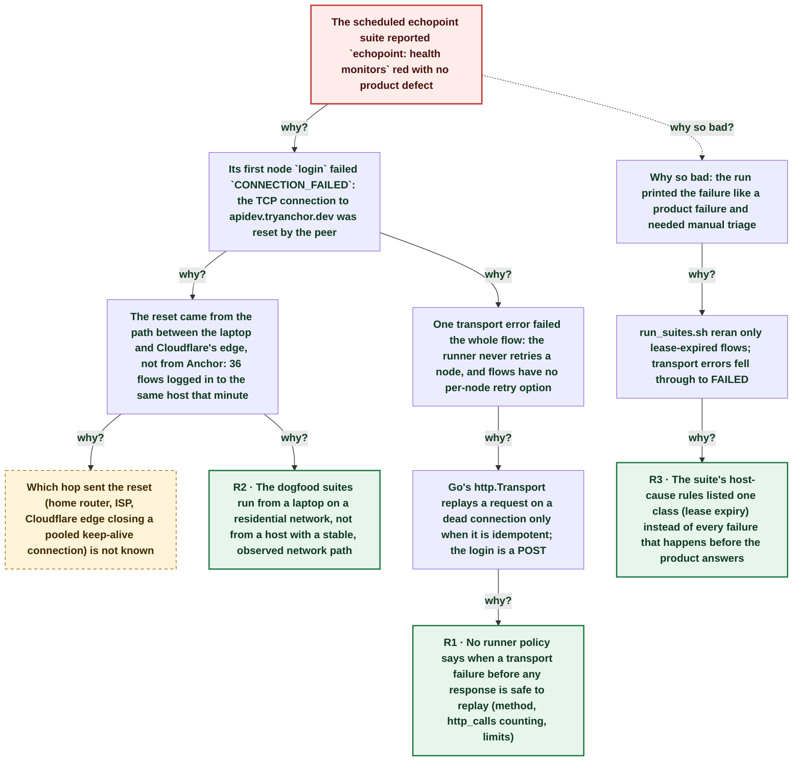

# Scheduled echopoint suite reported a false failure: one TCP reset on a login failed the whole flow because the runner never retries a node

| | |
|---|---|
| **Date** | 2026-10-21 |
| **Severity** | SEV4 |
| **Status** | In review |
| **Service** | echopoint-investigation routine (flow suites) / echopoint-runner |
| **Authors** | Nanostack routine (echopoint-investigation) |
| **Duration** | 1m 45s (trigger to resolution) |
| **Time to detect** | 1m 31s |
| **Time to mitigate** | 1m 42s |

> Blameless: this document names systems, processes and missing guards, not people.

## Summary

In the 17:08Z scheduled suite run, `echopoint: health monitors` failed in 353 ms on its first node: the `POST https://apidev.tryanchor.dev/v1/auth/login` connection from the laptop was reset by the peer (Cloudflare edge address). Anchor was healthy: 36 other flows logged in to the same host within the same minute and passed. The runner has a retry middleware but no production code wires it, so a single transport error fails the node and the flow. `run_suites.sh` only reran lease-expired flows, so the failure was printed like a product failure and needed manual triage. Two reruns passed. `run_suites.sh` now reruns once any flow that failed on a transport error before a response from a dev API, and the flow-suite-testing skill names this diagnosis class.

## Impact

One false red flow in the echopoint suite (36/37). Dev APIs only, no customer impact, nothing created before the failure so nothing leaked.

- **1 / 61** flows falsely red
- **353 ms** from start to failed
- **0** product defects

## Trigger

The TCP connection carrying the `login` POST to `apidev.tryanchor.dev` (172.64.80.1:443) was reset by the peer at 17:11:13Z.

## Detection

`run_suites.sh` printed `FAILED echopoint ce39b646…: Could not connect to apidev.tryanchor.dev … connection reset by peer` at the end of the run, 91 s after the failure. Detection was good enough: the script reads each failed flow's error. Only the classification was missing.

## Resolution

The flow was rerun twice by hand at 17:12:55Z and 17:12:58Z, both green. `run_suites.sh` now does the rerun itself and prints `TRANSPORT-RERUN` so the cause stays visible.

## Timeline (UTC)

| Time | | Event |
|---|---|---|
| 17:08:08 | T−3m 05s | **Scheduled routine run starts on AC power** `pmset -g batt`: AC Power, 100%. No sleep/wake in the run window. |
| 17:10:19 | T−54s | **echopoint tag starts (37 flows, embedded CLI runner)** First execution `01a15f71-3f5a…` (UUIDv7 time). Patched CLI from `feat/workspace-auth` because of the open SEV2 on released CLIs. |
| 17:11:13 | T+0s | **`login` POST reset by peer; flow fails** Execution `01a15f72-1151-728d-82f7-06feaf5776a8`, started 17:11:13.489Z, failed 17:11:13.842Z: `read tcp 192.168.2.50:52576->172.64.80.1:443: read: connection reset by peer`. Cleanup nodes skipped: no upstream output existed. |
| 17:12:44 | T+1m 31s | **run_suites.sh prints FAILED with the transport error** echopoint 36/37. The rerun rule only matched `runner lease expired before completion`. |
| 17:12:55 | T+1m 42s | **Rerun 1 green** Execution `01a15f73-a148-7b63-a81a-c0a1c79347c8`, 2000 ms. |
| 17:12:58 | T+1m 45s | **Rerun 2 green** Execution `01a15f73-aae0-7c49-be93-82dc84e34246`, 2135 ms. |
| ~17:40 | T+28m 47s | **run_suites.sh reruns transport failures once; skill lesson** |

## Root cause analysis: the five whys

Start at the impact and ask why until the answer is something the team can change. Solid edges ask why it happened; dashed edges ask why the impact was as large as it was.

- **Problem:** The scheduled echopoint suite reported `echopoint: health monitors` red with no product defect
  - **Why?** Its first node `login` failed `CONNECTION_FAILED`: the TCP connection to apidev.tryanchor.dev was reset by the peer _Evidence: runs/2026-10-21T17/echopoint.log line 40: `error_code: CONNECTION_FAILED … read: connection reset by peer`_
    - **Why?** The reset came from the path between the laptop and Cloudflare's edge, not from Anchor: 36 flows logged in to the same host that minute _Evidence: Same run: 36/37 echopoint and 24/24 anchor green; apidev.tryanchor.dev /health HEALTHY 23dc3796 at 17:08Z_
      - **Why?** Which hop sent the reset (home router, ISP, Cloudflare edge closing a pooled keep-alive connection) is not known → _open, still investigating_
      - **Why?** The dogfood suites run from a laptop on a residential network, not from a host with a stable, observed network path _Evidence: Same host decision as the 2026-10-17 host-sleep postmortem (action A3 there, still open)_ → **Root cause R2** (fixed by A4, A5)
    - **Why?** One transport error failed the whole flow: the runner never retries a node, and flows have no per-node retry option _Evidence: echopoint-runner v0.94.0 and main: `engine.Retry` / `runner.Retry` are called only from tests and docs (`git grep 'Retry('`)_
      - **Why?** Go's http.Transport replays a request on a dead connection only when it is idempotent; the login is a POST _Evidence: net/http Transport docs: retries only idempotent requests (or ones with an Idempotency-Key header) on reused connections_
        - **Why?** No runner policy says when a transport failure before any response is safe to replay (method, http_calls counting, limits) → **Root cause R1** (fixed by A1)
  - **Why so bad?** Why so bad: the run printed the failure like a product failure and needed manual triage _Evidence: run_suites.sh printed `FAILED echopoint ce39b646…`, not a rerun_
    - **Why?** run_suites.sh reran only lease-expired flows; transport errors fell through to FAILED _Evidence: run_suites.sh before 2026-10-21: one branch on `runner lease expired before completion`_
      - **Why?** The suite's host-cause rules listed one class (lease expiry) instead of every failure that happens before the product answers → **Root cause R3** (fixed by A2, A3)

## Root causes

- **R2** The dogfood suites run from a laptop on a residential network, not from a host with a stable, observed network path
- **R1** No runner policy says when a transport failure before any response is safe to replay (method, http_calls counting, limits)
- **R3** The suite's host-cause rules listed one class (lease expiry) instead of every failure that happens before the product answers

## Contributing factors

- The suites currently run on a CLI built from an unmerged branch (open SEV2 on released CLIs), so the run already carried manual steps.
- The node error carries a code (`CONNECTION_FAILED`) in the runner log but the execution list only returns the message, so the script matches message prefixes.

## Lessons learned

### What went well

- run_suites.sh reads each failed flow's error, so the transport cause was visible in the run output.
- The runner's error classifier named the class (`CONNECTION_FAILED`) and kept the raw cause.

### What went wrong

- The host-cause rule from 2026-10-17 covered one symptom, not the class.
- A runner retry middleware has existed for months without a production caller or a decision on it.

### Where we got lucky

- The reset hit the first node. On a create node (for example `create-org`) after the server had written, the `always` cleanup that reads its output would be skipped (`Source node not executed yet`) and a throwaway org could leak.
- The suite is dev-only; the same reset on a Cloud monitor would fail a customer's run with no replay.

## Action items

| ID | Action | Type | Owner | Due | Status | Ticket | Fixes |
|---|---|---|---|---|---|---|---|
| A1 | Decide and implement a runner policy for transport failures before any response: e.g. replay once for idempotent methods or nodes marked retryable, count the replay in `http_calls` | prevent | echopoint-runner maintainers | 2026-11-04 | open |  | R1 |
| A2 | `run_suites.sh` reruns once a flow that failed on a transport error (connect/reset, refused, TLS, DNS) before a response from a dev API and prints `TRANSPORT-RERUN`; a second failure stays FAILED | mitigate | echopoint-investigation routine | 2026-10-21 | done |  | R3 |
| A3 | flow-suite-testing skill: a transport failure before a response is a host or network cause; rerun once, a repeat is an outage | process | echopoint-investigation routine | 2026-10-21 | done |  | R3 |
| A4 | Decide the suite host (always-on host or Cloud launches); same decision as the 2026-10-17 host-sleep postmortem A3 | prevent | workspace owner | 2026-11-04 | open |  | R2 |
| A5 | Sweep throwaway Anchor orgs that outlive their flow run (dev nanostack product), so a skipped cleanup cannot accumulate | detect | echopoint-investigation routine maintainers | 2026-11-04 | open |  | R2 |

## Responders

- **Investigator**: Nanostack routine (echopoint-investigation)

## Messaging

### Internal

Suite 17:08Z: `echopoint: health monitors` red on a TCP reset to apidev.tryanchor.dev (laptop network), green on rerun x2. No product defect. run_suites.sh now reruns transport failures once.

### Customers

None: dev only.

## Supporting information

- [Report (artifact)](https://claude.ai/artifact/A5GaVMm56qRjpfeiGmGiKT)
- [Previous host-cause postmortem (2026-10-17)](https://claude.ai/artifact/JFgnKfLB3chZaAv2mU3RcS)
