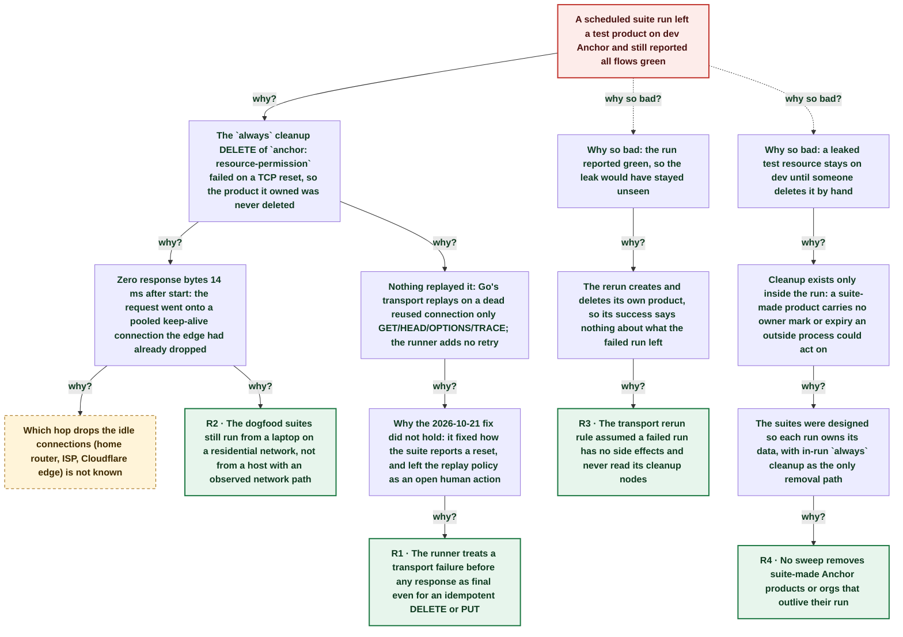

# Suite transport resets came back and one hit an `always` cleanup: a test product leaked on dev while the rerun reported green

| | |
|---|---|
| **Date** | 2026-10-23 |
| **Severity** | SEV4 |
| **Status** | In review |
| **Service** | echopoint-investigation routine (flow suites) / echopoint-runner |
| **Authors** | Nanostack routine (echopoint-investigation) |
| **Duration** | 4m 58s (trigger to resolution) |
| **Time to detect** | ~3m 28s |

> Blameless: this document names systems, processes and missing guards, not people.

## Summary

Regression of the [2026-10-21 suite transport reset](2026-10-21-suite-transport-reset.md). In the 17:08Z scheduled run, two anchor flows failed on TCP resets from the Cloudflare edge within one minute: `anchor: resource-permission` on its `always` cleanup `DELETE /v1/products/{id}` (14 ms) and `anchor: auth` on a `POST /v1/auth/refresh` (21 ms). `run_suites.sh` reran both, as the 2026-10-21 fix intended, and both passed, so the run read 25/25. The failed cleanup had left product `prd_3L6X…` on dev Anchor; the green rerun created and deleted its own product, so nothing reported the leftover. The routine found it by reading the failed execution's node results and deleted it at 17:15Z. `run_suites.sh` now prints `TRANSPORT-LEAK` for every `always` node that did not complete, and the flow-suite-testing skill says to clean before trusting a rerun.

## Impact

One throwaway product left on dev Anchor for about 5 minutes; two false red flows, both cleared by the automatic rerun. Dev APIs only, no customer impact.

- **1** test product leaked
- **2 / 64** flows falsely red
- **14 ms** DELETE start to reset

## Trigger

At 17:10:14Z the `cleanup-product` DELETE of `anchor: resource-permission` to `apidev.tryanchor.dev` (172.64.80.1:443) was reset by the peer before any response byte.

## Detection

`run_suites.sh` printed `TRANSPORT-RERUN` for both flows at about 17:13:42Z and both reruns passed. The leak itself was found only because the routine read the failed execution's node results by hand (`GET /flows/{id}/executions/{exec}/nodes`: `cleanup-product` failed with input `prd_3L6X…`). Detection of the leak was not good enough: nothing in the script looked at side effects of a failed run (fixed by A2).

## Resolution

A one-off flow logged in, read the product (200), deleted it (204) and read it again (404) at 17:15:12Z; the flow was deleted after. `run_suites.sh` now reports every `always` node of a transport-failed execution that did not complete, with its method, path and inputs, before the rerun.

## Timeline (UTC)

| Time | | Event |
|---|---|---|
| 17:11:13 | T−1d 23h | **First transport reset; fix = rerun transport failures once** [SEV4 suite transport reset](2026-10-21-suite-transport-reset.md). Its lucky list named this exact risk: a reset on a create or cleanup node can leak a resource. Runner replay (A1) and a sweep (A5) stayed open for humans. |
| ~05:10 | T−1d 12h | **Ledger row moved to verified after two clean runs** |
| 17:08:47 | T−1m 27s | **Scheduled run starts on AC power, released CLI v3.3.1** `pmset -g batt`: AC Power; no sleep/wake in the run window. No merges since the previous run; dev+prod at main. |
| 17:10:14 | T+0s | **Cleanup DELETE reset by peer; product left behind** Execution `01a169bd-d0c4-7244-bd20-d6d30f7d555e`, node `cleanup-product`: `http_calls` status 0, response_bytes 0, 14 ms, `read tcp 192.168.2.50:56982->172.64.80.1:443: read: connection reset by peer`. |
| 17:11:09 | T+55s | **Second reset: POST /v1/auth/refresh in `anchor: auth`** Execution `01a169be-6dbf-7258-b467-58f5bfbe8987`, node `replay-rotated-token`, 21 ms. The same second the runner's progress POST to `api.echopoint.dev` (same edge IP) was also reset. |
| ~17:13 | T+3m 28s | **run_suites.sh prints TRANSPORT-RERUN for both flows** Reruns `01a169c1-0fc1…` and `01a169c1-2232…` completed. The run reads anchor 25/25, echopoint 39/39. |
| ~17:14 | T+4m 16s | **Routine reads failed node results: cleanup-product failed** Input `create-product.productId = prd_3L6XIOLyPW33ACl1ObuXOgN5Hkl`. |
| 17:15:12 | T+4m 58s | **One-off flow deletes the leaked product (204, then 404)** Execution `01a169c2-6eba…`; get-before 200, delete 204, get-after 404. Temporary flow deleted. |
| ~17:40 | T+29m 46s | **TRANSPORT-LEAK report in run_suites.sh; skill line** |

## Root cause analysis: the five whys

Start at the impact and ask why until the answer is something the team can change. Solid edges ask why it happened; dashed edges ask why the impact was as large as it was.

- **Problem:** A scheduled suite run left a test product on dev Anchor and still reported all flows green
  - **Why?** The `always` cleanup DELETE of `anchor: resource-permission` failed on a TCP reset, so the product it owned was never deleted _Evidence: Node results of execution `01a169bd…`: `cleanup-product` failed `CONNECTION_FAILED`, `status_codes [0]`, input `prd_3L6X…`; the one-off GET at 17:15Z returned 200_
    - **Why?** Zero response bytes 14 ms after start: the request went onto a pooled keep-alive connection the edge had already dropped _Evidence: `http_calls[0].durations_ms [14]`, `response_bytes [0]`; the refresh POST failed the same way in 21 ms. A new TLS connection to the edge cannot be set up in that time_
      - **Why?** Which hop drops the idle connections (home router, ISP, Cloudflare edge) is not known → _open, still investigating_
      - **Why?** The dogfood suites still run from a laptop on a residential network, not from a host with an observed network path _Evidence: Same decision as 2026-10-21 A4 and 2026-10-17 A3, both still open_ → **Root cause R2** (fixed by A4)
    - **Why?** Nothing replayed it: Go's transport replays on a dead reused connection only GET/HEAD/OPTIONS/TRACE; the runner adds no retry _Evidence: net/http `Request.isReplayable`; echopoint-runner `pkg/node/cloud_dial.go` uses `&http.Client{}` for non-Cloud jobs; `engine.Retry` has no production caller (2026-10-21 evidence)_
      - **Why?** Why the 2026-10-21 fix did not hold: it fixed how the suite reports a reset, and left the replay policy as an open human action _Evidence: 2026-10-21 A1 status open, due 2026-11-04; the ledger row went to verified after two runs with no reset_
        - **Why?** The runner treats a transport failure before any response as final even for an idempotent DELETE or PUT → **Root cause R1** (fixed by A1)
  - **Why so bad?** Why so bad: the run reported green, so the leak would have stayed unseen _Evidence: run_suites.sh output: `TRANSPORT-RERUN` then `✓ Flow 7371aec8…: completed`; anchor 25/25_
    - **Why?** The rerun creates and deletes its own product, so its success says nothing about what the failed run left _Evidence: `anchor: resource-permission` creates a new product on every run (`create-product` POST)_
      - **Why?** The transport rerun rule assumed a failed run has no side effects and never read its cleanup nodes _Evidence: run_suites.sh before 2026-10-23: the transport branch only printed the error and reran_ → **Root cause R3** (fixed by A2, A3)
  - **Why so bad?** Why so bad: a leaked test resource stays on dev until someone deletes it by hand _Evidence: The product was still readable (200) 5 minutes after the failure_
    - **Why?** Cleanup exists only inside the run: a suite-made product carries no owner mark or expiry an outside process could act on _Evidence: `anchor: resource-permission` names its product per run; Anchor products have no TTL field_
      - **Why?** The suites were designed so each run owns its data, with in-run `always` cleanup as the only removal path _Evidence: Run notes: throwaway-org pattern; flow-suite-testing 'Cleanup survives failure'_
        - **Why?** No sweep removes suite-made Anchor products or orgs that outlive their run _Evidence: 2026-10-21 A5 open; the 2026-10-21 lucky list predicted this leak_ → **Root cause R4** (fixed by A5)

## Root causes

- **R2** The dogfood suites still run from a laptop on a residential network, not from a host with an observed network path
- **R1** The runner treats a transport failure before any response as final even for an idempotent DELETE or PUT
- **R3** The transport rerun rule assumed a failed run has no side effects and never read its cleanup nodes
- **R4** No sweep removes suite-made Anchor products or orgs that outlive their run

## Contributing factors

- The runner labels a read reset on an established connection as `transport_errors: connect` and `Could not connect to …`, which reads like a connect failure, not a dead pooled connection.
- The ledger moved the 2026-10-21 row to verified after two runs without a reset while its prevention actions were still open, so the recurrence first looked like a new event.

## Lessons learned

### What went well

- The 2026-10-21 rerun rule turned two resets into an automatic, labelled rerun instead of a manual triage.
- Node results keep the cleanup's inputs (`create-product.productId`), so the leaked id was one request away.

### What went wrong

- A lucky-list item (reset on a cleanup leaks data) became no guard; it happened two days later.
- A green rerun was read as a clean run.

### Where we got lucky

- The leaked resource was a product with no members or keys; a leaked throwaway org would also hold a live 15-minute org API key until it expires.
- The reset hit the cleanup, which reads back cleanly. On a create POST after the server wrote, the product id would be unknown and no node result would name it.

## Action items

| ID | Action | Type | Owner | Due | Status | Ticket | Fixes |
|---|---|---|---|---|---|---|---|
| A1 | Runner replays once a DELETE or PUT whose connection failed before any response byte (2026-10-21 A1, now with evidence: dead pooled keep-alive connections); count the replay in `http_calls` | prevent | echopoint-runner maintainers | 2026-11-04 | open |  | R1 |
| A2 | `run_suites.sh` prints `TRANSPORT-LEAK <flow> <node> <status> <method> <path> <inputs>` for every `always` node of a transport-failed execution that did not complete, before the rerun | detect | echopoint-investigation routine | 2026-10-23 | done |  | R3 |
| A3 | flow-suite-testing skill: before rerunning an interrupted flow, delete what its uncompleted cleanup nodes still own | process | echopoint-investigation routine | 2026-10-23 | done |  | R3 |
| A4 | Decide the suite host (always-on host or Cloud launches); same decision as 2026-10-21 A4 | prevent | workspace owner | 2026-11-04 | open |  | R2 |
| A5 | Sweep suite-made Anchor products and throwaway orgs on dev that outlive their run (2026-10-21 A5) | mitigate | echopoint-investigation routine maintainers | 2026-11-04 | open |  | R4 |

## Responders

- **Investigator**: Nanostack routine (echopoint-investigation)

## Supporting information

- [Report (artifact)](https://claude.ai/artifact/PvrHKWsmkFEKZYV7jhBv7m)
- [First occurrence (2026-10-21 postmortem)](https://claude.ai/artifact/A5GaVMm56qRjpfeiGmGiKT)
