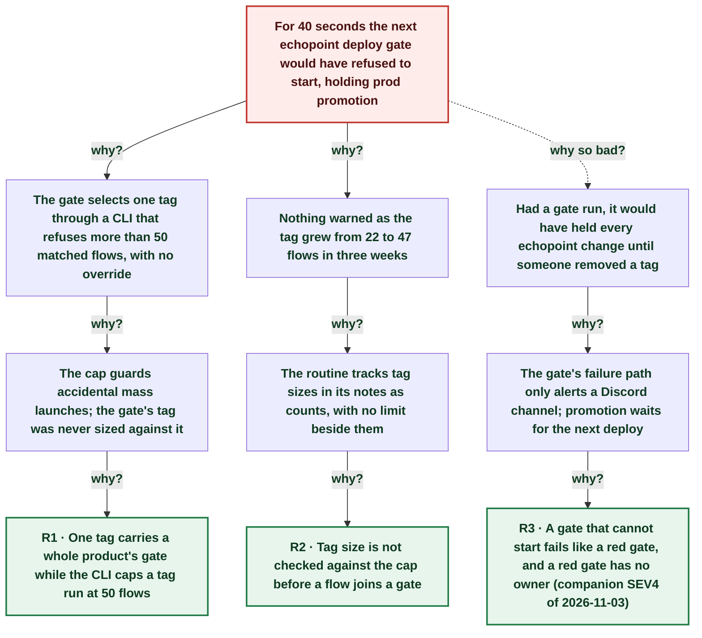

# Near miss: the echopoint gate tag grew past the CLI's 50-flow cap for 40 seconds

| | |
|---|---|
| **Date** | 2026-11-04 |
| **Severity** | SEV4 |
| **Status** | In review |
| **Service** | echopoint flow suites (post-deploy gate tag `echopoint`), echopoint CLI |
| **Authors** | Nanostack routine (echopoint-investigation) |
| **Duration** | 40s (trigger to resolution) |
| **Time to detect** | 5s |
| **Time to mitigate** | 40s |

> Blameless: this document names systems, processes and missing guards, not people.

## Summary

The routine tagged four security flows `echopoint` after echopoint#733 fixed their findings, taking the tag from 47 to 51 flows. `echopoint flows run --tag` refuses a tag that matches more than 50 flows (`maxTagResolvedFlows = 50`, no flag), and the post-deploy gate and Daily runs use the same CLI. The routine's own soak run exited 3 at once; the tags were reverted 40 seconds later. No gate ran in that window. The tag has three free slots left, so the next few new flows will hit the cap for real.

## Impact

None this time: no deploy gate ran between 00:25:37Z and 00:26:17Z. Had one run, the echopoint gate would have exited 3 and held prod promotion until the tag shrank.

- **51 / 50** flows in the tag vs the CLI cap
- **40 s** time the tag was over the cap
- **3** free slots left in the echopoint tag

## Trigger

Four `flows update` calls at 00:25:37Z added the `echopoint` tag to the F-1, F-3, F-4 and F-5 security flows.

## Detection

The routine's two-run concurrent soak, a step added the same night, printed `tag search matched 51 flows, exceeding the CLI safety cap of 50` and exit 3 within seconds.

## Resolution

The four flows went back to `sec-audit, security-guardrail` at 00:26:17Z: the Daily echopoint monitor (server-side, no cap found) still runs them, the gate does not. They passed twice on dev.

## Timeline (UTC)

| Time | | Event |
|---|---|---|
| 00:25:37 | T+0s | **Four security flows tagged echopoint (47 → 51)** |
| 00:25:42 | T+5s | **Soak run: tag matched 51 flows, cap 50, exit 3** |
| 00:26:17 | T+40s | **Tags reverted to sec-audit, security-guardrail** |
| 00:26:17 | T+40s | **echopoint tag back to 47; no gate ran meanwhile** |

## Root cause analysis: the five whys

Start at the impact and ask why until the answer is something the team can change. Solid edges ask why it happened; dashed edges ask why the impact was as large as it was.

- **Problem:** For 40 seconds the next echopoint deploy gate would have refused to start, holding prod promotion
  - **Why?** The gate selects one tag through a CLI that refuses more than 50 matched flows, with no override _Evidence: echopoint-cli `internal/commands/flow_run.go`: `const maxTagResolvedFlows = 50`; `flows run --help` lists no cap flag_
    - **Why?** The cap guards accidental mass launches; the gate's tag was never sized against it
      - **Why?** One tag carries a whole product's gate while the CLI caps a tag run at 50 flows → **Root cause R1** (fixed by A1, A2)
  - **Why?** Nothing warned as the tag grew from 22 to 47 flows in three weeks _Evidence: Run notes tag sizes: 22 on 2026-10-16, 44 on 2026-11-02, 47 on 2026-11-03_
    - **Why?** The routine tracks tag sizes in its notes as counts, with no limit beside them _Evidence: Run notes 'Tag sizes' line lists counts only_
      - **Why?** Tag size is not checked against the cap before a flow joins a gate → **Root cause R2** (fixed by A3)
  - **Why so bad?** Had a gate run, it would have held every echopoint change until someone removed a tag
    - **Why?** The gate's failure path only alerts a Discord channel; promotion waits for the next deploy _Evidence: infra `router.yml` `alert-deploy-failure`_
      - **Why?** A gate that cannot start fails like a red gate, and a red gate has no owner (companion SEV4 of 2026-11-03) → **Root cause R3** (fixed by A4)

## Root causes

- **R1** One tag carries a whole product's gate while the CLI caps a tag run at 50 flows
- **R2** Tag size is not checked against the cap before a flow joins a gate
- **R3** A gate that cannot start fails like a red gate, and a red gate has no owner (companion SEV4 of 2026-11-03)

## Contributing factors

- The routine's new soak step ran the tag before any gate could, which is why this stayed a near miss.

## Lessons learned

### What went well

- The CLI fails closed with an exact message instead of running a truncated suite.
- The soak step from the same night's postmortem caught it within seconds.

### What went wrong

- The routine knew the tag size (47) and did not compare it with the cap before tagging four flows.

### Where we got lucky

- No deploy ran in the 40 seconds; one merge at that time would have held echopoint prod promotion.

## Action items

| ID | Action | Type | Owner | Due | Status | Ticket | Fixes |
|---|---|---|---|---|---|---|---|
| A1 | Revert the four tags; flows run through the Daily monitor's sec-audit tag | mitigate | Nanostack routine (echopoint-investigation) | 2026-11-04 | done |  | R1 |
| A2 | Split the echopoint gate into two tags, or let the CLI page past 50 with an explicit flag | prevent | infra + echopoint-cli maintainers | 2026-11-10 | open |  | R1 |
| A3 | run_suites.sh prints TAG-NEAR-CAP when a tag holds 45+ flows; skill line to check the count before tagging | detect | Nanostack routine (echopoint-investigation) | 2026-11-04 | done |  | R2 |
| A4 | Owner for a red or unstartable gate (A5 of the gate-flows postmortem) | process | infra maintainers | 2026-11-17 | open |  | R3 |

## Responders

- **Detection and fix**: Nanostack routine (echopoint-investigation)

## Messaging

### Internal

The echopoint gate tag holds 47 flows and the CLI refuses tag runs above 50. Split the gate tag or add a paging flag before more flows land.

### Customers

None: no impact.

## Supporting information

- [Report (artifact)](https://claude.ai/artifact/T8Tt8vTgZPPzQdeDrkUs7J)
- [SEV4 gate flows pinned old behaviour](https://claude.ai/artifact/Xxmi3NC6ppsTvwJDKYczLZ)
