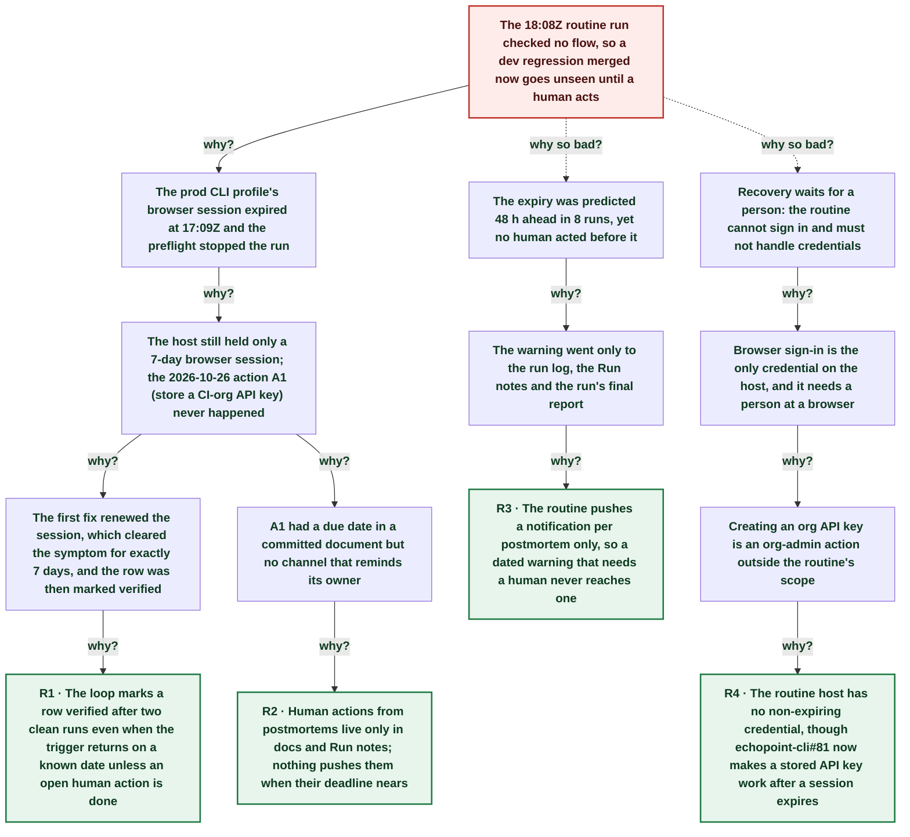

# Suite run blind again: the routine's prod CLI session expired after 8 unread warnings

| | |
|---|---|
| **Date** | 2026-11-05 |
| **Severity** | SEV4 |
| **Status** | In review |
| **Service** | echopoint-investigation routine (prod-org flow suites on dev) |
| **Authors** | Nanostack routine (echopoint-investigation) |
| **Duration** | ~1h 35m (trigger to resolution) |
| **Time to detect** | 58m 48s |
| **Time to mitigate** | ~1h 30m |

> Blameless: this document names systems, processes and missing guards, not people.

## Summary

The 18:08Z run of the scheduled flow-suite routine checked no flow: `run_suites.sh` stopped with `AUTH-EXPIRED`. The `prod` CLI profile still held only a 7-day browser session (signed in about 2026-10-29T17:09Z), which expired at 2026-11-05T17:09:37Z. This is a regression of the [2026-10-26 postmortem](2026-10-26-suite-cli-session-expired.md): its preflight worked and warned in 8 runs, and the CLI fallback (echopoint-cli#81) merged on 2026-11-02, but the one action that removes the trigger, storing a CI-org API key, had no date or owner who saw it, and the warnings only reached run reports. The ledger row was marked verified on two clean runs while that action was still open. Gates passed on the two backend merges of the window (echopoint 53/53, anchor 32/32), so no change went unchecked.

## Impact

One routine run (of four a day) checked 0 of 85 flows, and every later run stays blind until a human signs in or stores a key. New coverage for echopoint#746 and #747 waits. Customers saw nothing: the flows only target dev, and gates and the Daily monitor use separate credentials.

- **0 / 85** flows checked at 18:08Z
- **8** runs that warned AUTH-EXPIRES-SOON
- **2nd** expiry in 10 days

## Trigger

The `prod` profile's session JWT reached its `exp` at 2026-11-05T17:09:37Z.

## Detection

The 18:08Z run's preflight stopped with `AUTH-EXPIRED` before any launch, as designed. The expiry itself was predicted: `AUTH-EXPIRES-SOON` appeared in 8 run logs from 2026-11-03T18:08Z and in the Run notes as an urgent open item, but no notification reached a human.

## Resolution

Not resolved by the routine: re-authentication needs a person, and the routine never enters credentials. The routine now pushes a notification for every `AUTH-EXPIRES-SOON` or `AUTH-EXPIRED` line, and a ledger row whose trigger depends on an open human action can no longer be marked verified.

## Timeline (UTC)

| Time | | Event |
|---|---|---|
| 23:08:47 | T−9d 18h | **First expiry; preflight + CLI fallback actions created** [2026-10-26 postmortem](2026-10-26-suite-cli-session-expired.md): A1 store a CI-org API key (human), A2 echopoint-cli#81, A3 preflight (done). |
| ~17:09 | T−7d 00h | **A human signs in again: new 7-day browser session** `exp` minus 7 days; Run log 2026-10-29T23:08Z. No API key stored. |
| ~17:08 | T−6d 00h | **Ledger row moved to verified after two clean runs** Ledger row `flows:prod:suite-runner:stored credentials have expired`; A1 still open. |
| 20:35:55 | T−2d 20h | **echopoint-cli#81 merged (stored key survives expiry)** ([link](https://github.com/nanostack-dev/echopoint-cli/pull/81)) |
| ~18:08 | T−1d 23h | **First AUTH-EXPIRES-SOON warning (report line only)** `runs/2026-11-03T1808/suite.log`; repeated in 7 more runs up to `runs/2026-11-05T1208/run.log`. |
| 17:09:37 | T+0s | **Session JWT expires** `~/.echopoint/credentials/prod.json` keys `access_token`, `expires_at`, `organization_id`: no API key stored. |
| 17:34:34 | T+24m 57s | **Gate green on echopoint#746/#747 (53/53)** infra job 127415412871; anchor gate 32/32 at 17:46Z (job 127422027821). Gates use the CI key, not the host session. |
| 18:08:25 | T+58m 48s | **run_suites.sh stops: AUTH-EXPIRED (exit 2)** `runs/2026-11-05T1808/run.log`. |
| ~18:40 | T+1h 30m | **Warnings now pushed; verified rule tightened** Routine SKILL.md and `postmortem-loop.md` updated; flow-suite-testing skill line sharpened. |
| ~18:45 | T+1h 35m | **Impact bounded: human sign-in or API key requested by push** Suites stay blind until action A1. |

## Root cause analysis: the five whys

Start at the impact and ask why until the answer is something the team can change. Solid edges ask why it happened; dashed edges ask why the impact was as large as it was.

- **Problem:** The 18:08Z routine run checked no flow, so a dev regression merged now goes unseen until a human acts
  - **Why?** The prod CLI profile's browser session expired at 17:09Z and the preflight stopped the run _Evidence: `runs/2026-11-05T1808/run.log`: `AUTH-EXPIRED prod session expired at 2026-11-05T12:09:37-05:00`_
    - **Why?** The host still held only a 7-day browser session; the 2026-10-26 action A1 (store a CI-org API key) never happened _Evidence: `prod.json` keys `access_token,expires_at,organization_id`; 2026-10-26 postmortem A1 `open`_
      - **Why?** The first fix renewed the session, which cleared the symptom for exactly 7 days, and the row was then marked verified _Evidence: Ledger row status `verified (2026-10-30T17:08Z)` while A1 was open_
        - **Why?** The loop marks a row verified after two clean runs even when the trigger returns on a known date unless an open human action is done → **Root cause R1** (fixed by A3, A4)
      - **Why?** A1 had a due date in a committed document but no channel that reminds its owner
        - **Why?** Human actions from postmortems live only in docs and Run notes; nothing pushes them when their deadline nears → **Root cause R2** (fixed by A2)
  - **Why so bad?** The expiry was predicted 48 h ahead in 8 runs, yet no human acted before it _Evidence: `AUTH-EXPIRES-SOON` in `runs/2026-11-03T1808` … `runs/2026-11-05T1208`_
    - **Why?** The warning went only to the run log, the Run notes and the run's final report
      - **Why?** The routine pushes a notification per postmortem only, so a dated warning that needs a human never reaches one → **Root cause R3** (fixed by A2)
  - **Why so bad?** Recovery waits for a person: the routine cannot sign in and must not handle credentials
    - **Why?** Browser sign-in is the only credential on the host, and it needs a person at a browser
      - **Why?** Creating an org API key is an org-admin action outside the routine's scope
        - **Why?** The routine host has no non-expiring credential, though echopoint-cli#81 now makes a stored API key work after a session expires → **Root cause R4** (fixed by A1)

## Root causes

- **R1** The loop marks a row verified after two clean runs even when the trigger returns on a known date unless an open human action is done
- **R2** Human actions from postmortems live only in docs and Run notes; nothing pushes them when their deadline nears
- **R3** The routine pushes a notification per postmortem only, so a dated warning that needs a human never reaches one
- **R4** The routine host has no non-expiring credential, though echopoint-cli#81 now makes a stored API key work after a session expires

## Contributing factors

- The Run notes held the expiry as open item 41 marked URGENT, but the Run notes are read only by the next run, not by the human who must act.
- Post-deploy gates and the Daily monitor stayed green on separate credentials, so nothing else looked wrong.
- The push sent for this postmortem reached the desktop only (`Mobile push not sent (Remote Control inactive)`): A2 depends on a channel that is not always on, so R3 stays at risk while the owner is away from the laptop.

## Lessons learned

### What went well

- The preflight caught the expiry before any launch: no half-run flows, no leaked cleanup.
- Gates covered the window: both backend merges (echopoint#746, #747) passed 53/53 on dev before prod.

### What went wrong

- A predicted, dated failure happened anyway after 8 warnings.
- The first postmortem's verified status hid that its prevent action was still open.

### Where we got lucky

- The two backend merges of the window were small security fixes that the CI gates covered.
- The expiry hit between runs, not during one.

## Action items

| ID | Action | Type | Owner | Due | Status | Ticket | Fixes |
|---|---|---|---|---|---|---|---|
| A1 | Create a CI-org API key for the routine and store it: `echopoint auth login --profile prod --api-key <key> --default` (echopoint-cli#81 makes it survive the session); sign in again meanwhile | prevent | Workspace owner (human) | 2026-11-06 | open |  | R4 |
| A2 | Routine pushes a notification for every `AUTH-EXPIRES-SOON` or `AUTH-EXPIRED` preflight line, and for any dated human action due within 48 h | detect | Nanostack routine (echopoint-investigation) |  | done |  | R2, R3 |
| A3 | `postmortem-loop.md` §5: a row whose trigger returns unless an open human action is done stays `fix-live`, never `verified` | process | Nanostack routine (echopoint-investigation) |  | done |  | R1 |
| A4 | flow-suite-testing skill: a renewed browser session is a mitigation, not a fix; the run stays at risk until an API key is stored | process | Nanostack routine (echopoint-investigation) |  | done |  | R1 |

## Responders

- **Detection and write-up**: Nanostack routine (echopoint-investigation)

## Messaging

### Internal

Flow suites are blind since 17:09Z: the routine's prod CLI session expired again. Please store a CI-org API key with `echopoint auth login --profile prod --api-key <key> --default` (or sign in again). Gates and Daily are unaffected.

### Customers

None: dev-only test infrastructure.

## Supporting information

- [Atelier postmortem](http://nanostack-dev-1340p:4320/postmortems/01a1acea-63a5-7a86-9c2b-69a2becb0e79)
- [First postmortem (2026-10-26)](https://github.com/nanostack-dev/skills/blob/main/docs/postmortems/2026-10-26-suite-cli-session-expired.md)
- [echopoint-cli#81 (stored key after expiry, merged)](https://github.com/nanostack-dev/echopoint-cli/pull/81)
- [skills#52](https://github.com/nanostack-dev/skills/pull/52)
