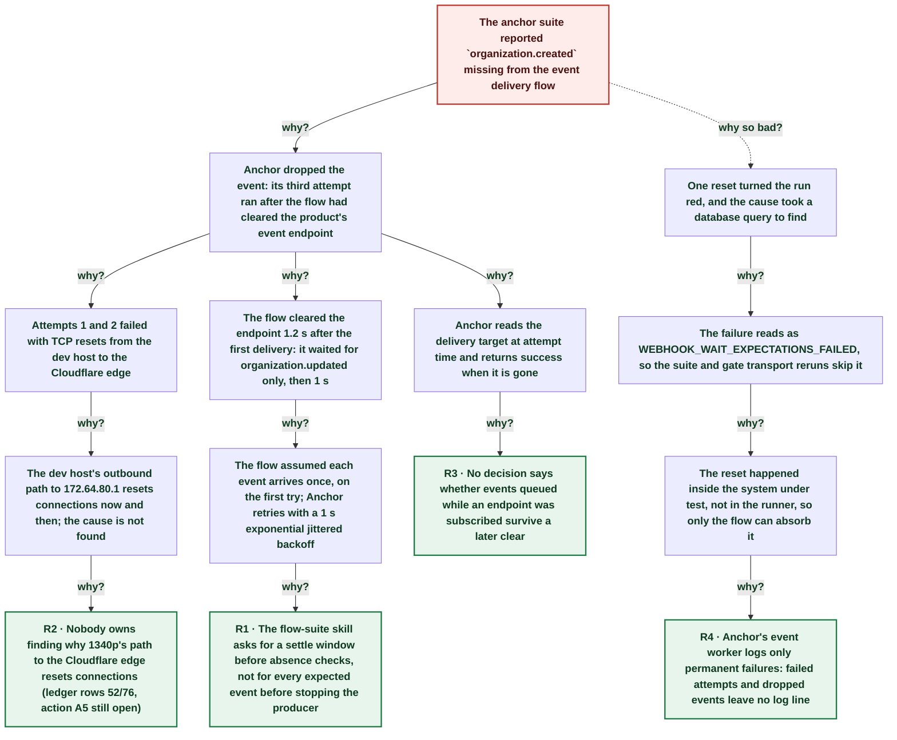

# Anchor suite red: a retried organization.created delivery landed after the flow cleared the event endpoint

| | |
|---|---|
| **Date** | 2026-11-12 |
| **Severity** | SEV4 |
| **Status** | In review |
| **Service** | anchor product events (dev) / anchor flow suite |
| **Authors** | Nanostack routine (echopoint-investigation) |
| **Duration** | 15m 05s (trigger to resolution) |
| **Time to detect** | 31s |
| **Time to mitigate** | ~7m 10s |

> Blameless: this document names systems, processes and missing guards, not people.

## Summary

The 18:08Z routine run of the anchor flow suite failed `anchor: product event delivery`: the `events` wait never received `organization.created`. Anchor's first two delivery attempts of that event hit a TCP reset from the dev host to the Cloudflare edge. The third attempt ran 10 ms after the flow cleared the product's event endpoint, so Anchor found no target and dropped the event without a log line. The flow waited only for `organization.updated` and a 1 s settle before the clear, which is shorter than Anchor's retry backoff. The flow now waits for both subscribed events before the clear; it is green 3x serial and in two tag soaks.

## Impact

Dev and CI only. One red flow in one routine suite run (anchor 32/33). The same race in an anchor post-deploy gate would hold prod: the gate reruns transport errors only, and this failure reads as an assertion failure.

- **1 of 33** anchor flows red in the 18:08Z run
- **2** delivery attempts reset by peer
- **10 ms** between the clear and the dropped retry

## Trigger

Two delivery attempts of `organization.created` (pgqueue job 382880) failed with `connection reset by peer` from 172.18.0.4 to 172.64.80.1 on the dev host 1340p.

## Detection

The routine's suite run reported the flow FAILED at 18:13:21Z (`1 of 3 expected events failed`). The cause was found in the dev pgqueue table: Anchor logs neither failed attempts nor dropped events, so VictoriaLogs showed nothing.

## Resolution

Three manual reruns were green. The flow was changed at 18:27:55Z: `wait-delivered` now has two groups (`organization.created` and `organization.updated`, min 1 each) and keeps the signature and no-secret checks at node level.

## Timeline (UTC)

| Time | | Event |
|---|---|---|
| 15:14:25 | T−9d 02h | **Flow saved: clear after first event + 1 s settle** `wait-delivered` asserted `$.type equals organization.updated` only. |
| 18:12:49 | T−0s | **Run creates product with an event endpoint** ([link](http://100.83.213.10:8428/select/vmui/)) |
| 18:12:49 | T−0s | **Org created; job 382880 enqueued (organization.created)** |
| ~18:12 | T+0s | **Delivery attempt 1 reset by peer** `last_error`: `read tcp 172.18.0.4:54810->172.64.80.1:443: read: connection reset by peer` (attempts 1 and 2; exact times not stored). |
| 18:12:50 | T+0s | **organization.updated delivered to the run webhook** Prod echopoint `POST /webhook/EsCj… -> 200`; the only delivery of the run. |
| 18:12:51 | T+2s | **Flow clears the endpoint (product PUT 200)** |
| 18:12:51 | T+2s | **Attempt 3 finds no target; job done, event dropped** Job available 18:12:51.326, done 18:12:51.382, no POST. |
| 18:13:21 | T+31s | **events wait fails: organization.created missing** |
| ~18:20 | T+7m 10s | **Three manual reruns green** |
| 18:27:55 | T+15m 05s | **Flow waits for both events before the clear** |
| ~18:35 | T+22m 10s | **Skill lesson and postmortem PR in nanostack-dev/skills** |

## Root cause analysis: the five whys

Start at the impact and ask why until the answer is something the team can change. Solid edges ask why it happened; dashed edges ask why the impact was as large as it was.

- **Problem:** The anchor suite reported `organization.created` missing from the event delivery flow
  - **Why?** Anchor dropped the event: its third attempt ran after the flow had cleared the product's event endpoint _Evidence: Dev `pgqueue_jobs` 382880: attempts 3, available 18:12:51.326, done .382; product PUT 18:12:51.316; one POST only in prod echopoint logs_
    - **Why?** Attempts 1 and 2 failed with TCP resets from the dev host to the Cloudflare edge _Evidence: Job `last_error`; same resets on the dev runner (18:03Z) and the routine host (18:1xZ) this hour_
      - **Why?** The dev host's outbound path to 172.64.80.1 resets connections now and then; the cause is not found
        - **Why?** Nobody owns finding why 1340p's path to the Cloudflare edge resets connections (ledger rows 52/76, action A5 still open) → **Root cause R2** (fixed by A5)
    - **Why?** The flow cleared the endpoint 1.2 s after the first delivery: it waited for organization.updated only, then 1 s _Evidence: Flow export `exports/product-event-delivery-pre-2026-11-12.json`: `wait-delivered` node assertions, `settle` 1000 ms_
      - **Why?** The flow assumed each event arrives once, on the first try; Anchor retries with a 1 s exponential jittered backoff _Evidence: `anchor/apps/anchor/internal/events/worker.go` BackoffBase 1 s, 6 attempts_
        - **Why?** The flow-suite skill asks for a settle window before absence checks, not for every expected event before stopping the producer → **Root cause R1** (fixed by A1, A2)
    - **Why?** Anchor reads the delivery target at attempt time and returns success when it is gone _Evidence: `worker.go` handleJob: `if !found { return nil }`_
      - **Why?** No decision says whether events queued while an endpoint was subscribed survive a later clear → **Root cause R3** (fixed by A4)
  - **Why so bad?** One reset turned the run red, and the cause took a database query to find
    - **Why?** The failure reads as WEBHOOK_WAIT_EXPECTATIONS_FAILED, so the suite and gate transport reruns skip it _Evidence: `run_suites.sh` transport regex; ci-workflows#42 reruns transport errors only_
      - **Why?** The reset happened inside the system under test, not in the runner, so only the flow can absorb it
        - **Why?** Anchor's event worker logs only permanent failures: failed attempts and dropped events leave no log line → **Root cause R4** (fixed by A3)

## Root causes

- **R2** Nobody owns finding why 1340p's path to the Cloudflare edge resets connections (ledger rows 52/76, action A5 still open)
- **R1** The flow-suite skill asks for a settle window before absence checks, not for every expected event before stopping the producer
- **R3** No decision says whether events queued while an endpoint was subscribed survive a later clear
- **R4** Anchor's event worker logs only permanent failures: failed attempts and dropped events leave no log line

## Contributing factors

- The anchor suite ran while the dev host showed resets to the edge (runner claim reset 18:03Z, three suite resets in the echopoint tag).

## Lessons learned

### What went well

- The dev pgqueue row kept attempts and the last error, which proved the drop.
- The transport-rerun and leak checks in `run_suites.sh` handled the three other resets of the run.

### What went wrong

- The flow modelled one delivery per event and no retry.
- Anchor logs no failed or dropped delivery.

### Where we got lucky

- The race hit a routine run, not an anchor post-deploy gate, where it would have held prod.
- The dev queue table had not yet pruned the done job.

## Action items

| ID | Action | Type | Owner | Due | Status | Ticket | Fixes |
|---|---|---|---|---|---|---|---|
| A1 | `wait-delivered` waits for organization.created and organization.updated (min 1 each) before the clear | prevent | Nanostack routine (echopoint-investigation) | 2026-11-12 | done |  | R1 |
| A2 | flow-suite-testing: wait for every expected event before a step that stops the producer | process | Nanostack routine (echopoint-investigation) | 2026-11-12 | done |  | R1 |
| A3 | Anchor event worker logs a warning per failed attempt and per event dropped for a missing target | detect | Anchor maintainers | 2026-11-26 | open |  | R4 |
| A4 | Decide (ADR) whether a cleared endpoint drops events queued while it was subscribed | process | Anchor maintainers | 2026-11-26 | open |  | R3 |
| A5 | Find why 1340p's path to the Cloudflare edge resets connections (existing gate-reset action) | mitigate | Infra maintainers | 2026-11-26 | open |  | R2 |

## Responders

- **Investigation**: Nanostack routine (echopoint-investigation)

## Messaging

### Internal

Anchor suite red on product event delivery: a retried organization.created landed after the flow cleared the endpoint and Anchor dropped it. Flow fixed (waits for both events), green 3x. Dev only.

## Supporting information

- [anchor: product event delivery, prod CI org flow f809a9a2-c534-40c4-93f7-f200df06f6a2](https://github.com/nanostack-dev/anchor/blob/main/apps/anchor/internal/events/worker.go)
- [Atelier](http://nanostack-dev-1340p:4320/postmortems/01a1d107-3aae-7d11-8e96-144e453b8339)
